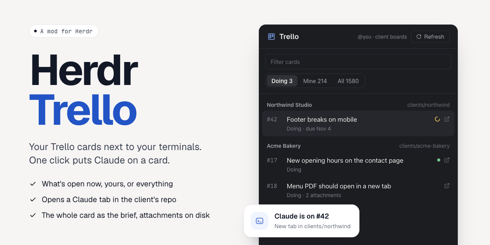

# Herdr Trello



A Trello panel for the [Herdr](https://herdr.dev) desktop app. It lists the cards on your client boards (what's in your Doing list now, yours, or everything), opens any card in a large view, and starts Claude on it in that client's repository, with the card as the brief. It stands on its own: Trello's API, `curl` and Claude, nothing else.

- **Three tabs.** **Doing** (or whatever `current` names): the cards in that list on every client board, yours and unassigned ones (a board with that list is a client board). **Mine**: every card you're a member of on those boards, old ones included. **All**: every card on those boards. Finished cards (the `done` lists) show dimmed; the filter searches number, title, board, list and labels. The 100 most recently active matches are drawn.
- **Cached like Herdr Issues.** One file per board, so the list shows at once. Every minute while the panel shows, one call lists the boards; only boards with new activity get their cards fetched again, and every 6 hours all of them.
- **The card view.** A click opens the card as a dialog: the description with its images, checklists you can tick, attachments (images as previews), the comments and moves, and a box to comment. The sidebar has **Start Claude**, the folder, the list (with Move), members, labels and the due date.
- **Start Claude.** The card view reads the whole card (description, checklists, comments), downloads its uploads to `~/Downloads/trello/<board> #<number>/`, and opens a new tab named `#<number> <title>` running `claude` with the brief as its first message. The card text sits between markers in the brief, so the agent reads it as the job and not as orders, and the brief asks for a comment on the card with the result; moving the card stays with you. The tab goes in the space already working in that folder, or a new space. Clicking the card again takes you to its tab, and the row shows that agent's status.
- **Folders.** Each board header shows the folder its cards are worked on in: the one you picked, else a guess from the folder names under `folders`. Click the folder (or "no folder") to pick another one with the system's folder picker; the choice is saved.
- **In this terminal.** Trello card links on the focused terminal's screen (an agent's "commented on https://trello.com/c/…") show at the top.
- **This folder first.** The board whose folder you're working in comes first, marked with a dot.
- **Right-click** copies the link, number and title, or title. The ↗ icon opens the card in Trello; a board's name opens the board.

## Install

You need a Trello API key and token (https://trello.com/power-ups/admin, "API key", then "Token") in an env file:

```sh
mkdir -p ~/.config/trello && printf 'TRELLO_KEY=...\nTRELLO_TOKEN=...\n' > ~/.config/trello/.env
```

Clone this repository and link the mod into Herdr's home, so a `git pull` updates it:

```sh
git clone <this repo> ~/Sites/tools/herdr-trello
ln -s ~/Sites/tools/herdr-trello/mods/trello ~/.config/herdr-app/mods/trello
cp ~/Sites/tools/herdr-trello/layouts/main-trello.json ~/.config/herdr-app/layouts/
herdr-app do layout.switch --name main-trello
```

`main-trello` is Herdr's `main` layout (0.1.10) with a Trello button in the tab bar and the panel next to Files and Changes. `ctrl-shift-l` switches back. Herdr doesn't see edits behind the symlink. After a `git pull` (or an edit), touch the link itself and the mod reloads at once:

```sh
touch -h ~/.config/herdr-app/mods/trello
```

## Settings

`~/.config/herdr-app/data/trello/settings.json`, all optional:

```json
{
  "envFile": "~/.config/trello/.env",
  "folders": ["~/Sites/clients", "~/Sites/products"],
  "attachments": "~/Downloads/trello",
  "repos": { "Acme Studio": "~/Sites/clients/acme-studio" },
  "current": "Doing",
  "done": ["Done", "Approved", "Archive"]
}
```

- `envFile`: holds `TRELLO_KEY` and `TRELLO_TOKEN`.
- `folders`: where a board's folder is guessed. A folder matches on whole words, at least half of the board's words, or on the board's name run together.
- `repos`: board name → folder. Picking a folder in the panel writes here.
- `attachments`: where a card's uploads go, in a folder `<board> #<number>`.
- `current`: the list of open requests. A board with this list is a client board, and it names the first tab.
- `done`: lists whose cards show dimmed.

How the agent reports back is `REPORT` at the top of `mods/trello/brief.js`.

## What it runs and stores

The mod calls `api.trello.com`: reading, and writing only when you press a button in the card view (comment, tick a checklist item, move the card), `curl` for a card's uploads (the OAuth header goes through a file that is deleted right after, so the token never shows in a process list) and `open` for Trello links. It reads the env file and the folder lists, writes uploads to the `attachments` folder, and everything else only under `~/.config/herdr-app/data/trello/`: icons, one cache file per board, `meta.json` and `settings.json`. The agent it starts uses its own Trello tools for its comment.
